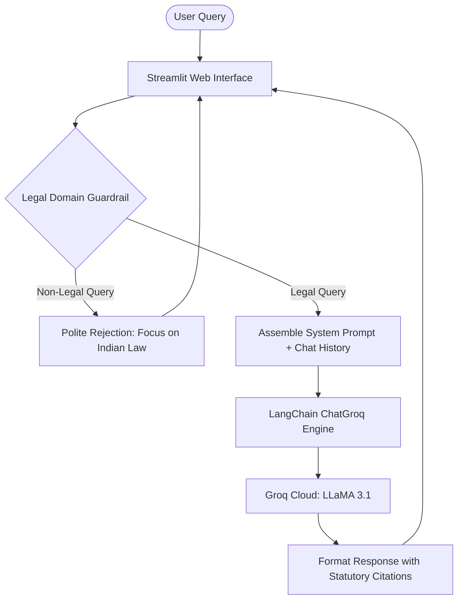

# ⚖️ Nyaya Sahayak (न्याय सहायक) — AI-Powered Legal Awareness Assistant

Nyaya Sahayak is an intelligent, conversational legal awareness assistant designed to demystify Indian law for citizens, students, and legal professionals. Built with **Streamlit**, **LangChain**, and **Groq (LLaMA 3.1)**, it delivers contextual, plain-language guidance strictly grounded in Indian statutory frameworks with built-in domain guardrails.

[](https://www.python.org/)
[](https://streamlit.io/)
[](https://www.langchain.com/)
[](https://groq.com/)
[](https://opensource.org/licenses/MIT)

---

## 🎯 Problem Statement & Goals

The Indian legal system encompasses intricate statutes, complex legal terminology, and significant recent overhauls (the transition from IPC, CrPC, and IEA to BNS, BNSS, and BSA). For the average citizen, understanding their basic rights and procedures is often intimidating and inaccessible.

**Nyaya Sahayak aims to:**
- Democratize access to legal literacy by answering common legal questions in simple, understandable terms.
- Emphasize updated statutory frameworks, including the **Bharatiya Nyaya Sanhita (BNS)**, **Bharatiya Nagarik Suraksha Sanhita (BNSS)**, and **Bharatiya Sakshya Adhiniyam (BSA)**.
- Implement strict domain guardrails to prevent hallucinations and keep responses focused strictly on Indian legal questions.

---

## ✨ Key Features

- **Broad Statutory Coverage**:
  - *Bharatiya Nyaya Sanhita, 2023 (BNS)*
  - *Bharatiya Nagarik Suraksha Sanhita, 2023 (BNSS)*
  - *Bharatiya Sakshya Adhiniyam, 2023 (BSA)*
  - *Constitution of India*
  - *Consumer Protection Act, 2019*
  - *Information Technology Act, 2000*
  - *Protection of Women from Sexual Harassment (POSH) Act, 2013*
  - *Protection of Children from Sexual Offences (POCSO) Act, 2012*
  - *Motor Vehicles Act, 1988*
- **Strict Legal Guardrails**: Automated filtering identifies non-legal queries (e.g., science, mathematics, coding, entertainment) and politely directs users back to legal topics.
- **Session-Based Conversation Memory**: Maintains chat context across turns to support follow-up inquiries and legal clarifications.
- **Ultra-Fast LLM Inference**: Powered by Groq's LPU inference engine running LLaMA 3.1 for near-instant response delivery.
- **Streamlit Interactive UI**: Intuitive web chat interface with sample legal prompts, conversation reset, and clear legal disclaimers.

---

## 🏛️ System Workflow



---

## 🛠️ Technology Stack

| Layer | Technology | Purpose |
|---|---|---|
| **User Interface** | [Streamlit](https://streamlit.io/) 1.37 | Conversational web interface and state management |
| **LLM Framework** | [LangChain](https://www.langchain.com/) & `langchain-groq` | Prompt management, message structuring, and LLM orchestration |
| **Inference Engine** | [Groq](https://groq.com/) API (`llama-3.1-70b-versatile` / `llama-3.1-8b-instant`) | Ultra-low-latency model execution |
| **Configuration** | `python-dotenv` | Secure local environment variable loading |
| **Language** | Python 3.10+ / 3.11+ | Application core logic |

---

## 🚀 Getting Started

### Prerequisites
- **Python**: Version 3.10 or higher
- **Groq API Key**: A free API key from [Groq Console](https://console.groq.com/keys)

---

### Installation

1. **Clone the repository:**
   ```bash
   git clone https://github.com/saurabhrdj50/nyaya-sahayak-chatbot.git
   cd nyaya-sahayak-chatbot
   ```

2. **Create and activate a virtual environment:**
   ```bash
   python3 -m venv .venv
   source .venv/bin/activate  # On Windows: .venv\Scripts\activate
   ```

3. **Install dependencies:**
   ```bash
   pip install -r requirements.txt
   ```

---

### Environment Setup

Create a `.env` file in the root directory modeled after `.env.example`:
```bash
cp .env.example .env
```

Open `.env` and add your Groq Cloud API key:
```env
GROQ_API_KEY=gsk_your_groq_api_key_here
```

---

### Running the Application

Launch the Streamlit web application:
```bash
streamlit run app.py
```

Once started, the application will be accessible at:
- **Local URL**: `http://localhost:8501`
- **Network URL**: displayed in the terminal output

---

## 📂 Project Structure

```
Nyaya-Sahayak_Chatbot/
├── app.py                # Main Streamlit web application & conversation handler
├── chains.py             # LangChain RAG / prompt processing chains
├── prompts.py            # System prompts & legal domain constraints
├── cache.py              # Redis query caching module (optional/extensible)
├── lawglance_main.py     # Base RAG pipeline class
├── check_models.py       # Helper utility for testing Groq API connectivity
├── pyproject.toml        # Project metadata and dependencies specification
├── requirements.txt      # Pinned Python package dependencies
├── .env.example          # Safe template for required environment variables
├── .gitignore            # Git exclusion rules
└── README.md             # Project documentation
```

---

## ⚖️ Legal Disclaimer

*Nyaya Sahayak is an educational and legal awareness tool powered by Artificial Intelligence. It does not constitute formal legal advice, representation, or an attorney-client relationship. Users should consult a qualified legal practitioner or advocate for formal legal counsel.*

---

## 👨‍💻 Maintainer

**Saurabh Gupta**
- GitHub: [@saurabhrdj50](https://github.com/saurabhrdj50)
- LinkedIn: [saurabh-gupta](https://www.linkedin.com/in/saurabh-gupta-9470372b6/)
- Repository: [nyaya-sahayak-chatbot](https://github.com/saurabhrdj50/nyaya-sahayak-chatbot)

---

## 🙏 Acknowledgements

- Built with modern open-source technologies including Python, Streamlit, LangChain, and Groq Cloud.
- [Groq](https://groq.com/) for fast LLM inference infrastructure.
- [LangChain](https://www.langchain.com/) and [Streamlit](https://streamlit.io/) open-source communities.
